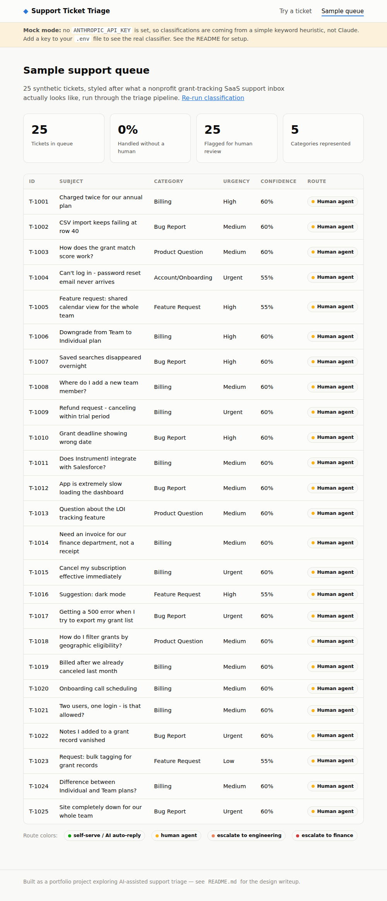
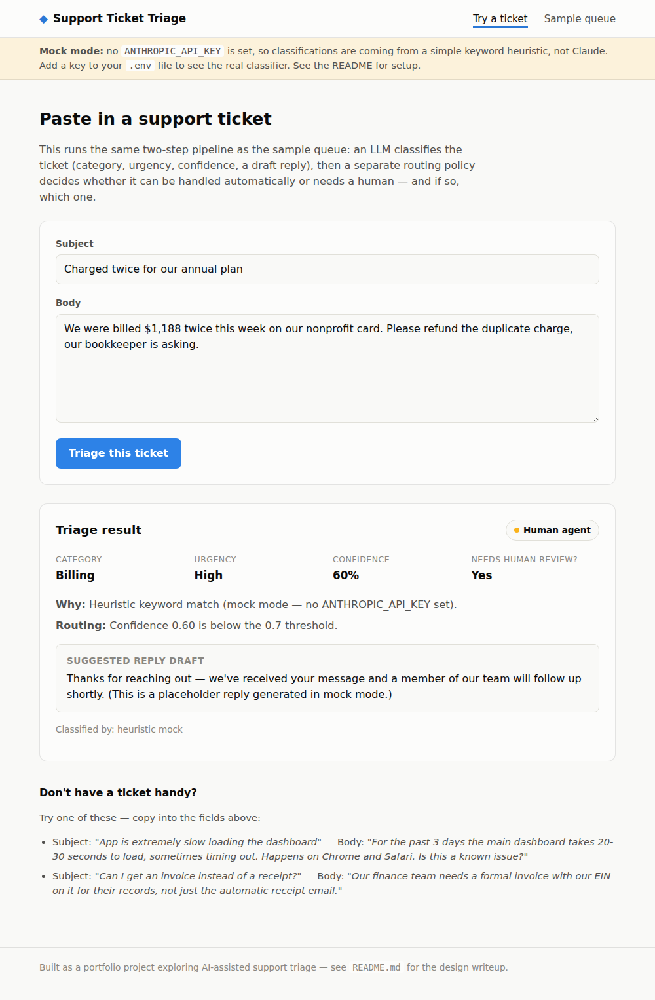

# Support Ticket Triage

A small AI-assisted triage engine for customer support tickets: it classifies
an incoming ticket (category, urgency, confidence, a draft reply), then a
separate, plain-Python **routing policy** decides whether it can be handled
by automation or needs a human — and which one.

I built this while applying for a Customer Support & Operations Team Lead
role at [Instrumentl](https://www.instrumentl.com/). The job asks for
someone who is "AI-native," already has opinions about where AI helps and
where it hurts in a support queue, and can own that quality without being
walked through it. My background is 5 years managing field service teams —
real queue management, escalations, and SLAs, just applied to trucks and
technicians instead of a help desk — so this project exists to show, not
just claim, that the support-tooling and AI-workflow side translates too.
The sample data is written to match Instrumentl's own world (nonprofits,
grant tracking, subscription billing) rather than a generic SaaS.

## Why it's built this way

The interesting design decision here isn't the LLM call — it's what's
**not** in the prompt. `classify_ticket()` only understands the ticket. A
separate function, `apply_routing_policy()`, decides what happens to it:
self-serve, an AI-drafted auto-reply, a human agent, or an escalation to
engineering or finance. That split matters because "where does automation
end and a human judgment call begin" is a policy decision a support lead
should own and be able to change by editing readable if/else logic — not
something that should live buried inside a prompt where it's invisible and
untestable.

A few of those policy calls, on purpose:

- **Low confidence always goes to a human**, regardless of what category the
  model guessed. Confidence is a safety net, not a vanity metric.
- **Anything urgent gets a human**, even if a category rule below would
  otherwise auto-reply.
- **Billing tickets always get a human reply.** Refunds and duplicate
  charges go further — to a finance-aware human — because that's real money
  and a wrong automated response is expensive in trust, not just refunds.
- **Account/access changes stay human-in-the-loop.** Automating who gets
  into an account is the wrong place to save time.
- **Feature requests and confident product questions** are the actual safe
  ground for automation — low stakes, easy to log or point at a help
  article.

## What's in here

| File | What it does |
|---|---|
| `triage.py` | The classifier (Claude API call + JSON parsing) and the routing policy. Falls back to a keyword heuristic if no API key is set, so the rest of the app still runs. |
| `data/tickets.json` | 25 synthetic, Instrumentl-flavored support tickets, each with a human-assigned ground-truth category/urgency for evaluation. |
| `app.py` + `templates/` | A small Flask demo: paste a ticket and see it triaged, or view the sample queue as a support inbox would. |
| `eval.py` | A QA harness — runs the labeled ticket set through the classifier and reports accuracy, a confusion matrix, and (the important one) **silent failures**: tickets the model got wrong *and* that weren't caught by the human-review safety net. |

## Screenshots

**Sample queue**, showing the automation/human split at a glance:



**A single ticket triaged**, with the routing reasoning shown alongside it:



(Both screenshots were taken in mock mode, so the confidence scores and
routing shown there are from the keyword heuristic, not Claude — see
"Mock mode" below.)

## Running it

```bash
git clone <this-repo>
cd support-ticket-triage
python -m venv venv && source venv/bin/activate   # optional but recommended
pip install -r requirements.txt

cp .env.example .env
# then edit .env and add your ANTHROPIC_API_KEY (https://console.anthropic.com/)

python app.py
# open http://127.0.0.1:5000
```

Run the QA eval separately:

```bash
python eval.py            # uses cached predictions if you've already run it once
python eval.py --refresh  # force a fresh classification pass
```

### Mock mode

If you don't set `ANTHROPIC_API_KEY`, everything still runs — `triage.py`
falls back to a small keyword-based heuristic classifier instead of calling
Claude. It's intentionally simple and not meant to be accurate; it exists so
the routing logic, the Flask UI, and the eval harness can all be exercised
(and reviewed) without needing an API key. The app shows a banner whenever
it's running in mock mode so it's never ambiguous which one produced a
result.

## Sample eval output

```
================================================================
TRIAGE CLASSIFIER — QA REPORT
================================================================
Tickets evaluated:        25
Category accuracy:        80.0%
Urgency exact-match acc:  28.0%

Per-category (support = # true examples in the eval set):
  Category             Support   Precision    Recall
  Billing                    6         55%      100%
  Bug Report                 7        100%      100%
  Product Question           6        100%       50%
  Account/Onboarding         3        100%       33%
  Feature Request            3        100%      100%

Misclassified tickets:    5
  caught by human-review safety net: 5 (100%)
  SILENT failures (wrong + auto-routed): 0
================================================================
```

(^ that run is from mock mode, which is deliberately weak — the honest
number worth watching is the **silent failure count**, not raw accuracy.
With the real classifier this both goes up in accuracy and gets more
interesting to tune the confidence threshold against.)

## How this maps to the role

| Instrumentl JD | This project |
|---|---|
| "AI-native instincts... own Fin/AI quality without being walked through it" | Built and tuned the classifier + confidence threshold myself; `eval.py` is exactly the QA loop this line asks for. |
| "Spot repetitive ticket categories that should be solved by AI... ship the fix" | The routing policy is the "fix" — a concrete, readable answer to which categories are safe to automate. |
| "Build lightweight QA loops so quality is something we measure, not something we hope for" | `eval.py`'s silent-failure metric is designed around that exact sentence. |
| "Build human-in-the-loop workflows so AI resolves more, and routes the rest to a human cleanly" | The confidence threshold + urgency/category safety nets in `apply_routing_policy()`. |
| "Build reporting that helps leadership see ticket volume, customer pain, team performance" | `/queue` view's stat row (volume, % auto-handled, review rate, category mix). |

## What I'd build next

- Swap the synthetic dataset for a small set of real (de-identified) tickets
  and re-tune the confidence threshold against them.
- Track routing decisions over time to see category drift, the way a real
  support queue's ticket mix shifts week to week.
- A feedback loop where a human's correction on a caught failure gets logged
  and periodically reviewed for prompt/threshold tuning — the actual "QA
  loop" a team would run in production, not just a one-off eval script.

## License

MIT — do whatever's useful with it.
